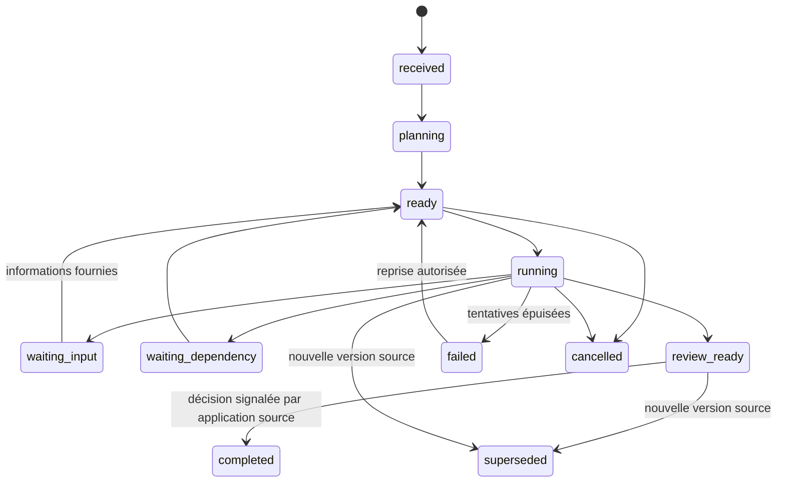

# Cycle de vie

Ce diagramme montre les parcours principaux; les transitions autorisées sont
définies dans [workflows.ts](../../packages/engine/src/workflows.ts).
`review_ready` signifie préparation prête, jamais approbation administrative.
`completed` clôt le suivi opérationnel après notification de la source; il ne
prouve pas une prestation livrée.

Une tâche a son propre état et ses tentatives. Une annulation ou une nouvelle
version invalide les exécutions en vol; un ancien résultat ne doit plus devenir
une proposition courante. Les erreurs sont conservées et les reprises auditées.
