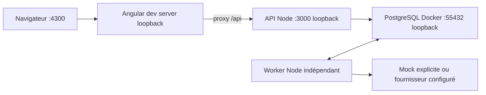

# Préparation opérationnelle v0.1

## Déploiement local

Commandes : [README](../../README.md). Compose démarre PostgreSQL avec volume
persistant et health check. Dockerfile construit le serveur Node22. Le profil
full est optionnel et exige une identité JWT configurée; ce n’est pas une
installation de production. Appliquer les migrations avant le démarrage.

## Compatibilité retenue

| Élément | Choix et vérification |
| --- | --- |
| Node | Cible22.12+, tests locaux Node24.21; tests et builds Node22 dans Docker, CI configurée |
| TypeScript | 5.9.3 strict et noUncheckedIndexedAccess |
| Angular | 21.2.26, CLI/build21.2.29; [matrice officielle](https://angular.dev/reference/versions) Node22.12+ et TS5.9 |
| Fastify | 5.12.8, plugin rate-limit compatible Fastify5 |
| PostgreSQL | 17.9-alpine, image réellement lancée |
| pg-boss | 12.38.0; [prérequis officiels](https://github.com/timgit/pg-boss) Node22.12+, PostgreSQL13+ |
| Contrats | Zod4.6.7, enveloppes strictes version1.0 |
| Packages | npm unique et package-lock.json |

## Limites explicites

- Funding/Social : événements de démonstration, aucun raccordement réel.
- IA : mock par défaut; OpenAI testé par fixtures HTTP, pas par appel live.
- Identité : JWT vérifiés; Keycloak réel et connexion PKCE console non raccordés.
- Résultats : schéma et contrôles déterministes, pas de mesure universelle de vérité.
- Coût : réservations conservatrices et estimations, pas de facturation fournisseur.
- Lots : export préparatoire, aucune approbation ni remise sortante automatique.
- File : reprise durable, sans promesse exactly-once sur les effets externes.
- Exploitation : sauvegardes/restauration, rétention, chiffrement et supervision à qualifier.
- Dépendances : audit runtime initial sans alerte; 16 alertes modérées dans la
  chaîne CLI Angular21 de développement, sans correction majeure forcée.

Les preuves reproductibles sont dans [validation.md](../validation.md).
Une simulation réussie n’est jamais qualifiée de test de production.
