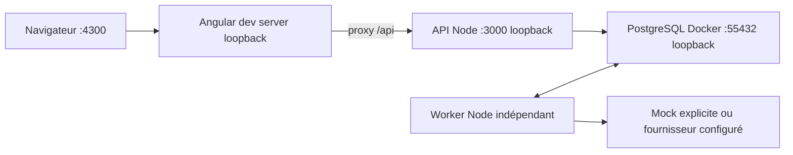

# Préparation opérationnelle v0.1

## Déploiement local

Commandes : [README](../../README.md). Compose démarre PostgreSQL avec volume
persistant et health check. Dockerfile construit le serveur Node22. Le profil
full est optionnel et exige une identité JWT configurée; ce n’est pas une
installation de production. Appliquer les migrations avant le démarrage.

## Compatibilité retenue

| Élément | Choix et vérification |
| --- | --- |
| Node | Cible22.12+, tests locaux Node24.21; tests et builds Node22 dans Docker, CI configurée |
| TypeScript | 5.9.3 strict et noUncheckedIndexedAccess |
| Angular | 21.2.26, CLI/build21.2.29; [matrice officielle](https://angular.dev/reference/versions) Node22.12+ et TS5.9 |
| Fastify | 5.12.8, plugin rate-limit compatible Fastify5 |
| PostgreSQL | 17.9-alpine, image réellement lancée |
| pg-boss | 12.38.0; [prérequis officiels](https://github.com/timgit/pg-boss) Node22.12+, PostgreSQL13+ |
| Contrats | Zod4.6.7, enveloppes strictes version1.0 |
| Packages | npm unique et package-lock.json |

## Limites explicites

- Funding : connecteur livré et testé localement; identité et liaison de production non qualifiées. Social reste démonstratif.
- IA : mock par défaut; OpenAI testé par fixtures HTTP, pas par appel live.
- Identité : JWT et console PKCE livrés; realm Keycloak réel non qualifié.
- Résultats : schéma et contrôles déterministes, pas de mesure universelle de vérité.
- Coût : réservations conservatrices et estimations, pas de facturation fournisseur.
- Lots : export préparatoire, aucune approbation ni remise sortante automatique.
- File : reprise durable, sans promesse exactly-once sur les effets externes.
- Exploitation : stack VPS, TLS PostgreSQL, secrets fichiers et santé livrés; sauvegardes/restauration et exploitation réelle restent à qualifier.
- Dépendances : audit runtime initial sans alerte; 16 alertes modérées dans la
  chaîne CLI Angular21 de développement, sans correction majeure forcée.

Les preuves sont dans le [bilan initial](../validation.md) et la
[recette Funding/VPS](../validation-funding-vps.md).
Une simulation réussie n’est jamais qualifiée de test de production.

## Travaux restants

Suivi du 2 novembre 2026. Les cases restent ouvertes tant que leur critère
opérationnel complet n’est pas atteint. Le code préparé et les recettes locales
ci-dessous ne qualifient pas un déploiement ou une identité de production.

### Code et recettes locales livrés

| Lots | Avancement vérifié | Qualification restante |
| --- | --- | --- |
| VPS-01/03 | Compose production, Angular/Nginx, TLS PostgreSQL privé, secrets fichiers, migrations et recette locale de 14 contrôles | Hôte réel, HTTPS public, sauvegarde/restauration hors VPS |
| VPS-02 | Console Authorization Code/PKCE S256, JWT/JWKS et contrôles state/nonce | Realm, clients, claims, sessions et politiques réels |
| VPS-05 | Redémarrages configurés, ressources bornées, santé API/web/worker et logs expurgés | Reboot hôte, supervision et alertes réelles |
| FUNDING-01/02 | Snapshot minimisé, révision monotone, outbox atomique et relais OAuth2 | Activation et identités de préproduction |
| FUNDING-03/04 | Invalidation par réconciliation, import privé contrôlé et panneau Funding en lecture seule; annulation service versionnée disponible | Événements de chaque mutation et branchement métier de l’annulation |
| FUNDING-06 | Activation Funding → OAuth/JWKS → API/worker PostgreSQL Preflight → proposition importée; refus tenant et versions testés | Identités et raccordement de préproduction |

Procédure : [déploiement VPS](../deployment-vps.md). Recette inter-dépôts :
`FUNDING_CONNECTOR_ROOT` désigne un checkout Funding compilé; exécuter
`npm run test:funding` depuis Preflight avec TEST_DATABASE_URL de test.

### Préparer le VPS

- [ ] **VPS-01 — Livraison production.** Qualifier sur le VPS le Compose livré,
  ses images identifiées, la configuration hors dépôt, Angular statique et
  le routage HTTPS préparé pour le proxy existant.
  Critère : accès console/API sur le VPS avec NODE_ENV=production, sans serveur
  Angular de développement ni modification du socle des autres applications.
- [ ] **VPS-02 — Identité réelle.** Raccorder issuer, audience, JWKS et claims
  tenant/applications/rôles; qualifier la connexion interactive OIDC/PKCE de la
  console et une identité de service Funding limitée à son périmètre.
  Critère : connexion humaine et appels de service vérifiés avec refus des
  mauvais rôles, tenants, audiences et applications.
- [ ] **VPS-03 — Persistance et secrets.** Configurer PostgreSQL privé avec TLS
  vérifié, comptes dédiés, secrets gérés et migrations exécutées lors de la
  livraison. Prévoir rétention et sauvegardes hors du VPS.
  Critère : restauration testée et données conservées après redémarrage;
  aucune valeur de démonstration utilisée en production.
- [ ] **VPS-04 — Fournisseur IA réel.** Configurer un modèle compatible, ses
  tarifs vérifiés, sa clé et l’activation explicite. Qualifier les sorties avec
  des exemples synthétiques et les limites de coût/temps.
  Critère : résultat réel avec provenance identifiable, schéma validé et
  échecs visibles; le mode mock reste refusé en production.
- [ ] **VPS-05 — Fonctionnement continu.** Qualifier les redémarrages et contrôles
  de santé livrés, régler les ressources selon la charge, puis raccorder les
  alertes sur erreurs/quarantaine, métriques et logs expurgés.
  Critère : reprise vérifiée après arrêt forcé et redémarrage du VPS, avec
  résultats déjà persistés préservés et erreurs consultables.
- [ ] **VPS-06 — Recette et mises à jour.** Tester une installation neuve, une
  mise à jour avec migrations et le retour à une version applicative compatible.
  Traiter ou justifier les alertes de dépendances de développement avant livraison.
  Critère : procédure reproductible documentée, preuves enregistrées et aucune
  prétention de haute disponibilité ou d’effet externe exactly-once.

### Raccorder Funding Platform

Le [parcours et les responsabilités](../connecting-applications.md#raccordement-de-funding-platform)
décrivent les échanges; les points ci-dessous suivent uniquement le travail restant.

- [ ] **FUNDING-01 — Contrat source.** Convenir du déclencheur métier, de l’objet
  analysé, du tenant et des données minimales. Définir la révision entière monotone
  attendue par Preflight et son lien avec le snapshot/les versions Funding;
  une empreinte ou un horodatage de préparation ne se recopie pas comme entier.
  Critère : contrat partagé revu et fixtures valides, invalides et obsolètes.
- [ ] **FUNDING-02 — Soumission durable.** Qualifier le connecteur Funding vers
  l’API Preflight, avec son intention d’envoi conservée dans la transaction
  métier et une émission réseau après commit, identifiants d’événement stables,
  reprises et rapprochement eventId/missionId.
  Réutiliser un mécanisme existant s’il fournit ces garanties; sinon prévoir
  une outbox transactionnelle et son relais.
  Critère : coupure réseau puis renvoi sans perte de mission ni préparation doublonnée.
- [ ] **FUNDING-03 — Changements source.** Transmettre les nouvelles révisions et
  les informations manquantes; définir le traitement des annulations et ses droits.
  Le rôle service_integration peut appeler /cancel avec sourceVersion et eventId,
  pour sa mission et sa version uniquement; le branchement Funding reste à définir.
  Critère : un ancien résultat reste bloqué malgré le désordre des événements.
- [ ] **FUNDING-04 — Retour des préparations.** Qualifier la consultation
  authentifiée des missions/résultats/propositions et leur présentation dans
  Funding, avec curseur ou suivi durable adapté au contrat disponible.
  La première option est une lecture par Funding; une remise automatique par
  webhook ou par deliverProposal est une extension à livrer séparément.
  Critère : contenu, provenance, version et exceptions visibles sans import
  direct dans un état métier approuvé ou publié.
- [ ] **FUNDING-05 — Autorité et lots.** Raccorder la revue aux services de Funding;
  revérifier droits, version/snapshot, concurrence, statut et consentements pour
  chaque dossier, y compris dans un lot. Notifier ensuite la décision déjà prise
  à Preflight avec une clé d’événement stable.
  Critère : une proposition obsolète ou hors périmètre ne peut provoquer de
  décision, et Preflight ne publie ni ne prend de décision financière.
- [ ] **FUNDING-06 — Recette entre applications.** Vérifier les deux côtés avec
  identités réelles de préproduction, doublons, pannes réseau, versions changées,
  permissions refusées, annulation, reprise et lots partiellement exclus.
  Critère : preuves de bout en bout avant d’annoncer Funding comme connectée.
