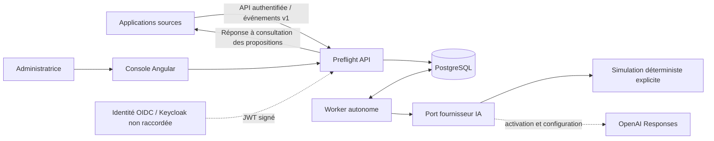
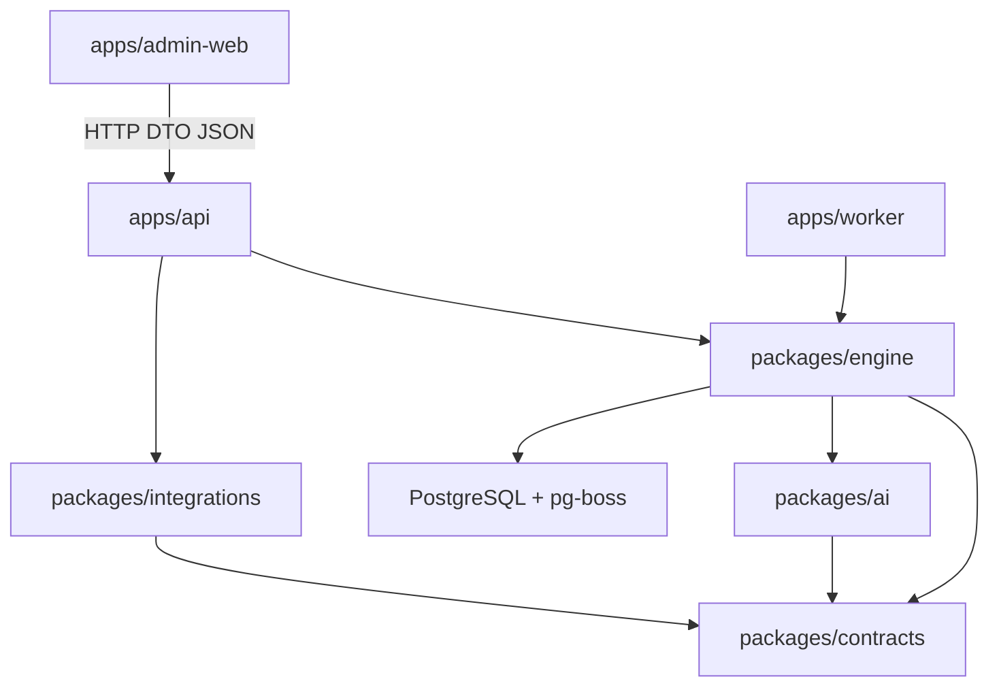

# Contexte et modules

Le serveur et le worker sont indépendants; le serveur ne lance pas les tâches IA.
Le moteur regroupe persistance, planification et orchestration dans des modules
internes d’un seul package pour éviter des packages vides. Seuls ses exports
publics sont consommés par les applications. Aucun accès aux bases métier externes.
