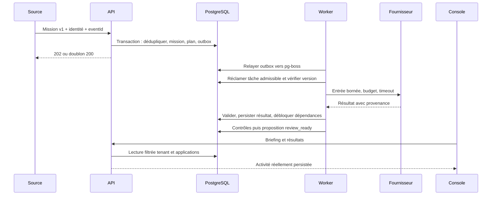

# Moteur et durabilité

Le plan initial est déterministe : inspection et politique indépendantes,
puis brouillon, contrôle de sortie et proposition. Le worker exécute les tâches
admissibles sans présence administrative. Le registre de workflows porte les
différences d’application; l’ordonnanceur reste générique.

PostgreSQL conserve missions, tâches, résultats, historique et outbox transactionnelle.
pg-boss fournit la file durable et ses reprises, sans Redis ni file distribuée maison.
La remise d’un message peut être répétée : le traitement vérifie état, version et
jeton de tentative avant de valider un résultat. Les tentatives sont bornées, avec
backoff; les échecs terminaux restent inspectables et peuvent être repris par un
opérateur autorisé. Une interruption ne supprime pas les résultats déjà validés.

Les appels fournisseurs sont bornés en temps et coût. Les réservations doivent
rester conservatrices en cas d’appel interrompu, car son coût distant peut être
inconnu. Aucune garantie exactly-once n’est revendiquée pour un effet externe.

Définition des workflows : [guide d’extension](../adding-workflows.md).
